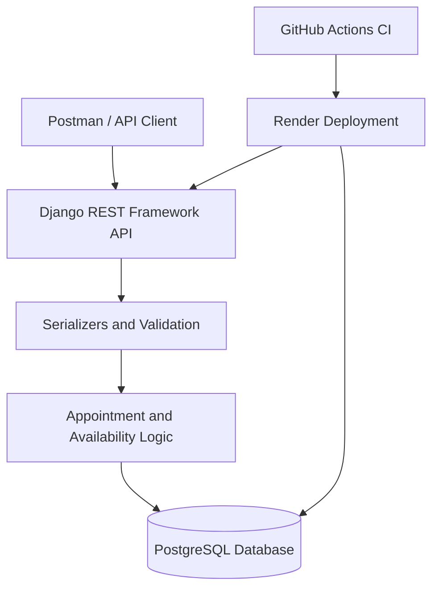
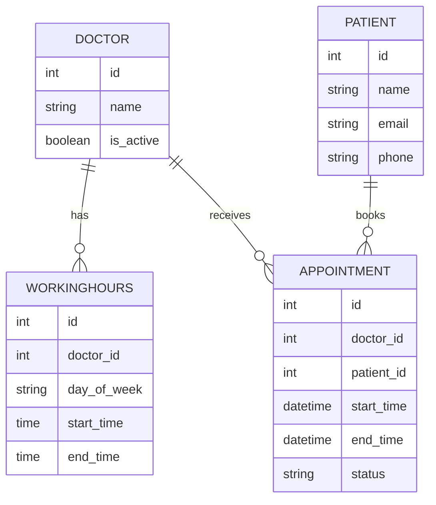

# Savannah Doctor Appointment Booking API

A RESTful API for managing doctors, their working hours, patients, and medical appointments. The system supports appointment availability discovery, booking, cancellation, rescheduling, and retrieval of upcoming appointments.

**Live deployment:** https://savannah-doctor-booking-api.onrender.com

**Technology stack:** Python 3.12, Django, Django REST Framework, PostgreSQL, GitHub Actions, Render, and Coverage.py.

---

## 1. System Design

### 1.1 Problem Statement

The system provides a backend for a doctor appointment booking service. It allows patients to identify doctors, check available appointment slots, book appointments, and manage existing bookings.

The system enforces scheduling rules to prevent invalid bookings, including advance-booking restrictions, conflicting appointments, and bookings with inactive doctors.

The assessment is implemented as an API-first application. A frontend is not required to exercise the core functionality; the endpoints can be tested using Postman or another HTTP client.

### 1.2 Objectives

- Maintain doctor records and their working schedules.
- Register patient information.
- Generate available appointment slots for a selected doctor and date.
- Create appointments with a fixed 30-minute duration.
- Reject appointments scheduled less than one hour ahead.
- Prevent conflicting active appointments.
- Support appointment cancellation and rescheduling.
- Retrieve appointments for individual doctors.
- List upcoming appointments in chronological order.
- Validate incoming requests and return meaningful HTTP responses.
- Automate code validation and testing through continuous integration.
- Deploy the API and database-backed application to a public hosting environment.

### 1.3 High-Level Architecture



**Component responsibilities**

- **API client:** Sends HTTP requests and receives JSON responses.
- **Django REST Framework:** Handles routing, request parsing, serialization, permissions, and HTTP responses.
- **Validation layer:** Checks required fields, input formats, doctor status, and scheduling constraints.
- **Appointment and availability logic:** Determines available slots and validates booking lifecycle operations.
- **PostgreSQL:** Persists doctors, working schedules, patients, and appointments.
- **GitHub Actions:** Runs automated checks and tests on pushes and pull requests targeting `main`.
- **Render:** Hosts the deployed application and provides access to the configured production database.

### 1.4 Data Models and Relationships

The domain is organized around four core entities.

#### Doctor

Represents a medical practitioner who can receive appointments.

Typical responsibilities:

- Store a doctor's identity and relevant professional details.
- Indicate whether the doctor is active.
- Associate the doctor with one or more working-hour records.
- Associate the doctor with their appointments.

An inactive doctor must not receive new appointments.

#### WorkingHours

Represents the periods during which a doctor is available for appointments.

A working-hours record is associated with a doctor and defines a working day and its start and end times.

The availability logic uses these records to generate candidate appointment slots. The implementation should validate that the start time precedes the end time and that generated slots fall within the doctor's working schedule.

#### Patient

Represents the person requesting an appointment.

The model stores the patient information required by the booking workflow, such as their name and contact details. Patient registration is separate from appointment creation so that a patient can be associated with appointments without requiring a separate user login.

#### Appointment

Represents a booking between a patient and a doctor.

An appointment links the relevant patient and doctor to a start time, end time, and booking status.

The model and associated validation logic enforce the appointment lifecycle, including booking, cancellation, and rescheduling.

The appointment duration is 30 minutes. Cancelled appointments should not block otherwise available slots.

> The descriptions above document the domain design. Exact field names, nullability, database constraints, and related names should be taken from the implemented Django models.

### 1.5 Entity Relationships



This diagram illustrates the logical relationships rather than guaranteeing that every displayed field has that exact name in the current implementation.

### 1.6 Appointment Scheduling Rules

The following rules define the intended scheduling behaviour.

1. **Appointment duration:** Each appointment occupies a 30-minute interval.
2. **Advance booking:** The appointment must start at least one hour after the current time.
3. **Doctor status:** New appointments cannot be created for inactive doctors.
4. **Working hours:** Appointments must fall within the selected doctor's working schedule.
5. **Conflict prevention:** Two active appointments for the same doctor cannot occupy overlapping time intervals.
6. **Cancellation:** Cancelled appointments no longer reserve the doctor's slot.
7. **Rescheduling:** The new slot must pass the same validation rules as a new booking. If rescheduling fails, the original booking must remain unchanged.
8. **Upcoming appointments:** Past and cancelled appointments are excluded, and remaining appointments are ordered by start time in ascending order.

For reliable scheduling, overlapping intervals should be checked using interval logic rather than simply comparing start times. For example, two intervals overlap when the first appointment starts before the second ends and ends after the second starts.

Where concurrent requests could book the same slot, the implementation should use appropriate database transactions and locking or database constraints to prevent duplicate active bookings.

### 1.7 Key Design Decisions and Trade-offs

**Django REST Framework**

- Provides a structured way to build REST endpoints, validate incoming data, serialize database records, and return appropriate HTTP status codes.
- Reduces the amount of low-level HTTP handling required.
- Trade-off: Framework conventions and serializer configuration must be understood to avoid inconsistent validation across endpoints.

**PostgreSQL**

- Provides persistent relational storage for doctors, working schedules, patients, and appointments.
- Supports transactions and database-level consistency controls.
- Trade-off: Requires database provisioning and configuration in local and production environments.

**Separate doctor schedules**

- Keeping working hours separate from doctor records supports multiple working days and different schedules.
- Trade-off: Availability calculation requires querying schedule records and generating candidate slots rather than reading a single field from the doctor.

**No separate doctor or patient login requirement**

- Keeps the assessment focused on appointment management rather than user authentication.
- Doctor and patient records can be provisioned through supported API operations or Django administrative tools.
- Trade-off: A production system would need additional authentication, authorization, patient privacy protections, and safeguards against unauthorized changes to doctor schedules.

**Fixed 30-minute appointment duration**

- Simplifies slot generation, booking validation, and conflict checking.
- Trade-off: Does not support appointments requiring different durations without extending the design.

**Availability computed from schedules and existing appointments**

- Avoids maintaining a separate stored record for every possible free slot.
- Helps availability reflect bookings and cancellations.
- Trade-off: Availability must be recalculated for requests, and the booking operation must validate the selected slot again to handle concurrent requests safely.

**Monolithic application**

- Keeps the assessment easy to develop, test, deploy, and maintain.
- Trade-off: As the product grows, components may need clearer service boundaries or independent scaling.

---

## 2. API Implementation and Testing

### 2.1 Project Structure

The repository uses Django's application structure, with the appointment functionality organized in the `appointments` application and project-level configuration in `config`.

A simplified view of the expected layout is:

```text
savannah-doctor-booking-api/
├── appointments/
│   ├── models.py
│   ├── serializers.py
│   ├── views.py
│   ├── urls.py
│   ├── tests.py
│   └── migrations/
├── config/
│   ├── settings.py
│   ├── urls.py
│   └── ...
├── requirements.txt
├── manage.py
└── .github/
    └── workflows/
        └── ...
```

The exact filenames can differ depending on how settings, views, tests, and URL routing are organized in the repository.

### 2.2 Prerequisites

For local development, install:

- Python 3.12.
- PostgreSQL 16 or a compatible PostgreSQL version.
- Git.
- Postman, curl, or another HTTP client.

You should also have access to the project repository and be able to install the dependencies in `requirements.txt`.

### 2.3 Local Installation

Clone the repository and enter the project directory:

```bash
git clone <YOUR_GITHUB_REPOSITORY_URL>
cd <YOUR_REPOSITORY_DIRECTORY>
```

Create a virtual environment:

**Windows PowerShell**

```powershell
py -3.12 -m venv .venv
.venv\Scripts\Activate.ps1
```

**Linux or macOS**

```bash
python3.12 -m venv .venv
source .venv/bin/activate
```

Install the dependencies:

```bash
python -m pip install --upgrade pip
pip install -r requirements.txt
```

### 2.4 Configure the Local Database

Create a PostgreSQL database and database user for local development. For example, in PostgreSQL:

```sql
CREATE DATABASE savannah_db;
CREATE USER savannah_user WITH PASSWORD 'change-this-password';
GRANT ALL PRIVILEGES ON DATABASE savannah_db TO savannah_user;
```

Depending on the PostgreSQL version and privileges required by your migrations, you may also need to grant the user appropriate schema privileges.

Configure Django using the environment variable names supported by the project's settings. The supplied CI workflow uses the following names:

```text
DJANGO_SECRET_KEY
DJANGO_DEBUG
DJANGO_ALLOWED_HOSTS
TIME_ZONE
DB_NAME
DB_USER
DB_PASSWORD
DB_HOST
DB_PORT
```

For local development, the database settings could correspond to:

```text
DB_NAME=savannah_db
DB_USER=savannah_user
DB_PASSWORD=<your-local-password>
DB_HOST=127.0.0.1
DB_PORT=5432
TIME_ZONE=Africa/Nairobi
DJANGO_DEBUG=True
DJANGO_ALLOWED_HOSTS=localhost,127.0.0.1
```

These are configuration examples, not a claim that Django automatically reads a `.env` file. Use the environment-loading mechanism configured by the project. Never commit real database passwords or production secrets.

### 2.5 Apply Migrations and Start Django

Run the Django configuration check:

```bash
python manage.py check
```

Apply database migrations:

```bash
python manage.py migrate
```

Start the local development server:

```bash
python manage.py runserver
```

The default local base URL is:

`http://127.0.0.1:8000`

If doctor and working-hours records must be created through Django Admin, create an administrator account if the project has the admin site configured:

```bash
python manage.py createsuperuser
```

Then visit:

`http://127.0.0.1:8000/admin/`

Register the required models with Django Admin if they are not already registered. Alternatively, use the implemented API endpoints or any supplied seed-data command.

### 2.6 API Endpoint Reference

The following table documents the principal appointment operations. The appointment and availability paths shown reflect the routes discussed during development; confirm the final paths, request fields, and response schemas against `config/urls.py`, `appointments/urls.py`, and the serializers before publishing them as a definitive API contract.

Let the base URL be:

- Local: `http://127.0.0.1:8000`
- Production: `https://savannah-doctor-booking-api.onrender.com`

| Operation | Method | Endpoint pattern |
|---|---|---|
| List doctors | GET | `/api/doctors/` |
| Create a doctor, if exposed | POST | `/api/doctors/` |
| Configure a doctor's working hours, if exposed | POST | `/api/doctors/{doctor_id}/working-hours/` |
| Register a patient, if exposed | POST | `/api/patients/` |
| Get a doctor's available slots | GET | `/api/doctors/{doctor_id}/availability/?date=YYYY-MM-DD` |
| Book an appointment | POST | `/api/appointments/` |
| List upcoming appointments | GET | `/api/appointments/upcoming/` |
| Get a single appointment | GET | `/api/appointments/{appointment_id}/` |
| Cancel an appointment | PATCH | `/api/appointments/{appointment_id}/cancel/` |
| Reschedule an appointment | PATCH | `/api/appointments/{appointment_id}/reschedule/` |
| Get appointments for a doctor | GET | `/api/doctors/{doctor_id}/appointments/` |

**Important:** The doctor-creation, working-hours, patient-registration, and per-doctor appointment routes above describe the requested operations, but their exact implementation has not been independently verified here. If an operation is not exposed by the current URL configuration, provision the relevant data through the configured administrative interface or implement the endpoint before documenting it as available.

### 2.7 Doctor Management

Doctors must have records in the database before they can receive appointments.

Doctor creation should validate required fields and initialize the doctor as active or inactive according to the supplied data and business rules.

Example request body for a hypothetical doctor-creation endpoint:

```json
{
  "name": "Dr. Jane Doe",
  "is_active": true
}
```

Use the actual field names required by the implemented doctor serializer.

To add working hours, associate a schedule with the doctor and specify the working day, start time, and end time.

Illustrative request body:

```json
{
  "day_of_week": "MONDAY",
  "start_time": "09:00",
  "end_time": "17:00"
}
```

The working-hours endpoint should reject invalid time ranges and any other schedule conflicts prohibited by the implementation. Availability calculations should use the doctor's configured working hours rather than assuming every doctor works the same schedule.

### 2.8 Patient Registration

Patients must be identifiable when an appointment is created.

If patient registration is exposed through the API, it should validate the required patient details and return the newly created patient identifier. If patients are managed through Django Admin or another provisioning mechanism, use the resulting patient ID when creating an appointment.

Illustrative patient request:

```json
{
  "name": "John Doe",
  "email": "john.doe@example.com",
  "phone": "+254712345678"
}
```

The exact payload depends on the implemented model and serializer. Do not assume that a patient email or phone number is unique unless the database or validation logic enforces that requirement.

### 2.9 Check Available Slots for a Doctor

**Method:** `GET`

Example:

```text
/api/doctors/1/availability/?date=2026-10-20
```

The request identifies the doctor and date for which availability is required.

The availability calculation should:

1. Verify that the doctor exists.
2. Retrieve the doctor's working hours for the selected day.
3. Generate candidate 30-minute appointment slots.
4. Exclude slots that are in the past or do not satisfy the one-hour advance-booking rule.
5. Exclude slots overlapping active appointments.
6. Return the remaining slots.

The date in this example is illustrative; choose a future date for testing.

### 2.10 Book an Appointment

**Method:** `POST`

Example:

```text
/api/appointments/
```

An illustrative request body is:

```json
{
  "doctor_id": 1,
  "patient_id": 1,
  "start_time": "2026-10-20T10:00:00+03:00"
}
```

This payload assumes the API accepts doctor and patient IDs and a start timestamp. If the implementation accepts nested patient information or uses different field names, use the actual serializer schema.

The booking operation should:

- Validate the doctor and patient references.
- Reject bookings for inactive doctors.
- Validate the selected date and time against working hours.
- Ensure the appointment is at least one hour in the future.
- Calculate the end time based on the 30-minute duration.
- Reject conflicts with existing active appointments.
- Persist the appointment and return the created record.

A successful creation normally returns `201 Created`. Validation errors normally return `400 Bad Request`, although the actual response contract depends on the implementation.

### 2.11 Get All Appointments for a Doctor

**Method:** `GET`

If the per-doctor endpoint is implemented:

```text
/api/doctors/1/appointments/
```

It should return appointments associated with the specified doctor. The response should have a consistent schema and ordering. If the endpoint is intended to return all appointments, clarify whether it includes past, cancelled, and future appointments.

This operation is distinct from the upcoming-appointments endpoint, which filters out past and cancelled appointments.

If this route is not present in the current implementation, the same result can be obtained through a suitably filtered query endpoint or added as a dedicated API operation.

### 2.12 Retrieve Upcoming Appointments

**Method:** `GET`

```text
/api/appointments/upcoming/
```

The endpoint should return future appointments that have not been cancelled, ordered by appointment start time in ascending order.

Verify that the earliest upcoming appointment appears first and that past or cancelled appointments do not appear in the result.

### 2.13 Retrieve an Appointment by ID

**Method:** `GET`

```text
/api/appointments/1/
```

Replace `1` with an actual appointment ID.

The endpoint should return the appointment's details if it exists. An unknown appointment ID should return `404 Not Found`.

### 2.14 Cancel a Booked Appointment

**Method:** `PATCH`

```text
/api/appointments/1/cancel/
```

The cancellation operation should transition the appointment to its cancelled state. If the endpoint does not require a request body, the PATCH request can be sent without one.

Verify that:

- The appointment is marked as cancelled.
- The cancelled appointment is excluded from upcoming appointments.
- Its slot becomes available again if no other booking occupies it.
- Repeated cancellation attempts are handled consistently.

Cancellation should update the existing appointment rather than silently deleting its history.

### 2.15 Reschedule an Appointment

**Method:** `PATCH`

```text
/api/appointments/1/reschedule/
```

An illustrative request body is:

```json
{
  "start_time": "2026-10-20T11:00:00+03:00"
}
```

The endpoint should validate the proposed time against the same rules as a new booking.

A successful reschedule updates the appointment's start and end times. If the target slot is invalid or occupied, the operation must be rejected without losing the original appointment.

### 2.16 Error Handling

The API should use HTTP status codes consistently.

| Status | Typical meaning |
|---|---|
| `200 OK` | A retrieval or update succeeded. |
| `201 Created` | A resource was successfully created. |
| `400 Bad Request` | Request validation failed. |
| `404 Not Found` | The requested resource does not exist. |
| `405 Method Not Allowed` | The HTTP method is not supported by the endpoint. |
| `500 Internal Server Error` | An unexpected server-side error occurred. |

The actual response body should provide enough information to identify validation failures without exposing database credentials, secrets, or internal tracebacks.

### 2.17 Run Automated Tests Locally

Run the Django test suite:

```bash
python manage.py test
```

Run the test suite with coverage, matching the CI workflow:

```bash
coverage run --source=appointments,config manage.py test
coverage report -m
```

Check for missing migrations:

```bash
python manage.py makemigrations --check --dry-run
```

Run the Django system check:

```bash
python manage.py check
```

The test suite should cover:

- Successful doctor and patient operations supported by the API.
- Availability generation from working hours.
- Successful appointment creation.
- The one-hour advance-booking cutoff.
- Appointment duration.
- Inactive doctors.
- Overlapping appointments.
- Cancellation and slot reuse.
- Rescheduling to valid and occupied slots.
- Upcoming appointment filtering and chronological ordering.
- Invalid inputs and nonexistent resources.
- Concurrent booking attempts where appropriate.

At one point during development, the existing suite passed eight tests. That result reflects the suite at that point in time; rerun the current suite and coverage commands to establish the final result.

### 2.18 Test the Deployed API with Postman

Use the production base URL:

```text
https://savannah-doctor-booking-api.onrender.com
```

In Postman:

1. Create a collection named `Savannah Doctor Booking API`.
2. Add a collection variable named `base_url` with the deployed URL as its value.
3. Create requests using `{{base_url}}` as the prefix.
4. Select the appropriate HTTP method for each endpoint.
5. For JSON requests, choose **Body → raw → JSON**.
6. Inspect the status code, response body, and validation messages.
7. Test both successful requests and invalid cases.

For example:

```text
GET {{base_url}}/api/doctors/
GET {{base_url}}/api/doctors/1/availability/?date=2026-10-20
POST {{base_url}}/api/appointments/
GET {{base_url}}/api/appointments/upcoming/
PATCH {{base_url}}/api/appointments/1/cancel/
PATCH {{base_url}}/api/appointments/1/reschedule/
```

These requests assume the route paths listed earlier. Confirm each route against the deployed URL configuration.

For production testing, use designated test records and avoid creating or cancelling appointments belonging to real users.

---

## 3. Deployment and CI/CD

### 3.1 Public Deployment

The application is deployed on Render.

- **Public URL:** https://savannah-doctor-booking-api.onrender.com
- **Application framework:** Django REST Framework
- **Database:** PostgreSQL
- **Continuous integration:** GitHub Actions
- **Deployment branch:** `main`, provided the Render service is configured to deploy from that branch.

The base URL is the public service address. Individual API operations are accessed through the relevant endpoint paths.

### 3.2 Render Service Configuration

The Render deployment consists of the Django web service and a PostgreSQL database configured for the application.

The setup should include the following:

1. Connect the GitHub repository to Render.
2. Create or configure a Python web service.
3. Select `main` as the deployment branch if using that branch for production.
4. Configure the build command to install dependencies from `requirements.txt`.
5. Configure the start command to run the Django application using the production WSGI server and appropriate bind address and port.
6. Provision or connect a PostgreSQL database.
7. Configure the database connection and Django environment variables.
8. Apply database migrations during the deployment process or through a controlled release step.
9. Configure production hosts, HTTPS, logging, and secret management.
10. Verify the deployment using the public URL and Postman.

A typical build command is:

```bash
pip install -r requirements.txt
```

A typical Django start command using Gunicorn is:

```bash
gunicorn config.wsgi:application --bind 0.0.0.0:$PORT
```

Use this start command only if Gunicorn is installed and `config.wsgi:application` is the correct WSGI module for the repository.

A production deployment must not use Django's development server.

### 3.3 Production Environment Variables

Configure the environment variables expected by the project's Django settings through the Render dashboard.

The CI workflow currently uses these names:

```text
DJANGO_SECRET_KEY
DJANGO_DEBUG
DJANGO_ALLOWED_HOSTS
TIME_ZONE
DB_NAME
DB_USER
DB_PASSWORD
DB_HOST
DB_PORT
```

Their production values must be set separately from the CI test values. If the application reads a PostgreSQL connection URL instead, configure the variable expected by the settings implementation and ensure that it references the correct Render database.

Production configuration should:

- Use a strong, private Django secret key.
- Set `DJANGO_DEBUG` to `False`.
- Include the deployed hostname in `DJANGO_ALLOWED_HOSTS`.
- Use the production PostgreSQL credentials and connection details.
- Set `TIME_ZONE` to `Africa/Nairobi` if that is the intended application timezone.
- Keep secrets out of Git, README examples, and client-side code.

### 3.4 Database Migrations in Production

Django migrations synchronize the database schema with the application's model definitions.

The deployment process must ensure that required migrations are applied before the application relies on the updated schema.

The CI workflow runs migrations against its own temporary PostgreSQL database. Those migrations do not modify the Render production database.

Production migrations must therefore be handled by the Render deployment or a separate controlled deployment step.

### 3.5 GitHub Actions Workflow

The workflow is named **Savannah API CI**.

It runs on:

- Pushes to `main`.
- Pull requests targeting `main`.

The workflow uses Ubuntu, Python 3.12, and a PostgreSQL 16 service container.

The pipeline performs these steps:

1. Checks out the repository.
2. Sets up Python 3.12 and pip caching.
3. Installs dependencies from `requirements.txt`.
4. Runs `python manage.py check`.
5. Runs `python manage.py makemigrations --check --dry-run`.
6. Applies migrations to the temporary CI database.
7. Runs the Django tests with Coverage.py:

   ```bash
   coverage run --source=appointments,config manage.py test
   ```

8. Reports coverage and missing lines:

   ```bash
   coverage report -m
   ```

The coverage report uses `if: always()`, so GitHub Actions attempts to run it even if an earlier step fails.

The workflow is designed to detect configuration issues, missing migrations, and failing tests before changes are accepted. It reports coverage but does not currently enforce a minimum coverage threshold.

### 3.6 How Deployment Is Triggered

There are two separate mechanisms:

**Continuous integration:** GitHub Actions executes the workflow when code is pushed to `main` or a pull request targets `main`.

**Production deployment:** Render deploys the application according to its own service configuration. If automatic deployment is enabled for `main`, a new commit to that branch triggers a deployment.

A successful GitHub Actions run does not automatically deploy the application unless an explicit deployment action is also configured in the workflow. The provided YAML performs tests and coverage reporting, not deployment.

### 3.7 Production Verification Checklist

After deployment, verify that:

- The Render service starts without application errors.
- The database connection succeeds.
- Migrations have been applied.
- The public API returns expected responses.
- Doctor and working-hours data can be retrieved or provisioned through the supported mechanism.
- Available slots reflect working hours and existing appointments.
- Invalid bookings are rejected.
- Cancellation releases the slot.
- Rescheduling preserves the original booking when the proposed slot is invalid.
- Upcoming appointments exclude cancelled and past appointments.
- The deployed service uses production settings rather than CI test credentials.

---

## 4. AI Usage and Reflection

### 4.1 What did you use AI for across the four sections?

- **System design:** I used AI to help interpret the assessment requirements, identify the domain entities and API operations, and evaluate design options for scheduling and appointment management.
- **API implementation:** I used AI as a coding assistant to explore Django REST Framework patterns, request validation, appointment lifecycle operations, and PostgreSQL integration.
- **Testing and deployment:** I used AI to identify edge cases, improve the test plan, troubleshoot configuration issues, and document GitHub Actions, Render, and Postman workflows.
- **Documentation and reflection:** I used AI to structure the README, explain architectural decisions and trade-offs, and articulate how AI contributed to the development process.

I treated AI as an assistant rather than an authority. I remained responsible for checking suggestions against the assessment requirements and the application's actual behaviour.

### 4.2 Give one example where an AI suggestion improved your work. What did you prompt it with?

One example was improving the appointment booking test plan.

**Example prompt:**

> Review the appointment booking requirements and recommend additional tests covering the one-hour booking cutoff, overlapping appointments, inactive doctors, rescheduling conflicts, cancellation, invalid input, and chronological ordering of upcoming appointments.

The response highlighted edge cases that basic successful-booking tests would not cover. These recommendations helped expand the testing plan to include rejection scenarios and appointment lifecycle behaviour, making the verification process more comprehensive.

The value was not simply generating more tests, but identifying conditions under which the API could accept an invalid booking or produce an inconsistent result.

### 4.3 Give one example where AI output was wrong or incomplete and how you caught it.

One limitation was that AI-generated API examples could assume endpoint paths, request fields, or response structures that were not necessarily identical to the application's implementation.

I addressed this by checking the actual Django URL configuration and serializers and by running the relevant requests or tests. When a suggested example did not match the implemented API, the route, payload, or test had to be corrected rather than accepted blindly.

This demonstrated why generated examples must be verified against executable code and observed responses. A plausible-looking request is not evidence that an endpoint exists or behaves as expected.

### 4.4 Name two decisions you made without AI. Why did you trust your own judgment there?

**Decision 1: Selecting the core technology stack.**

I chose Django REST Framework and PostgreSQL for the backend, GitHub Actions for continuous integration, and Render for deployment.

I trusted this decision because the stack provides relational data management, structured request validation, automated testing, and a practical way to expose the API publicly. These choices were based on the project requirements and the need to demonstrate a deployable, testable backend.

**Decision 2: Defining the core appointment scheduling rules.**

I treated the 30-minute appointment duration, one-hour advance-booking restriction, prevention of conflicting active appointments, and exclusion of cancelled and past appointments from upcoming results as core business rules.

I trusted my judgment because these rules determine whether the booking system behaves consistently and reliably. They needed to be derived from the assessment requirements and implemented as enforceable application rules, rather than accepted or changed solely because an AI tool suggested an alternative.

### 4.5 Reflection

AI was most useful for accelerating exploration, suggesting additional tests, troubleshooting, and improving documentation. However, generated output required verification, particularly when it referred to specific routes, database behaviour, or deployment configuration.

The final responsibility for requirement interpretation, architectural choices, implementation correctness, and production verification remained with me as the developer.

---

## Conclusion

The Savannah Doctor Appointment Booking API provides a backend foundation for doctor scheduling and appointment management. Its design separates doctors, working hours, patients, and appointments; its validation rules support reliable scheduling; and its development workflow uses Django tests and GitHub Actions to validate changes.

The application is publicly deployed at:

**https://savannah-doctor-booking-api.onrender.com**

